<a href="https://github.com/emilio-araya">
  <picture>
    <source media="(prefers-color-scheme: dark)" srcset="assets/banner-dark.v2.svg">
    <source media="(prefers-color-scheme: light)" srcset="assets/banner-light.v2.svg">
    
  </picture>
</a>

 

---

## `$ whoami`

  

Estudiante de **Ingeniería en Informática** (Duoc UC, Chile), orientado al desarrollo backend. Me interesa lo que pasa cuando un sistema deja de ser un CRUD: concurrencia, consistencia de datos, autenticación entre servicios e infraestructura reproducible.

- 🎯 Busco mi primera posición backend: práctica o junior, remoto o en Santiago
- 🌱 Profundizando en Spring Security, OAuth2 y OpenID Connect; concurrencia y niveles de aislamiento; AWS (networking e IAM) y Terraform
- 👯 Me interesa colaborar en proyectos de backend, cloud y ciberseguridad

---

## `$ ls ~/projects`

- 📦 **[Pedidos360](https://github.com/emilio-araya/pedidos360-infra)**: frontend React, un BFF y dos microservicios Spring Boot sobre Oracle. Validación JWT de Entra ID y Cognito, reservas de stock idempotentes con locks pesimistas, Flyway, tests de integración y concurrencia, y Terraform para AWS.
   Repositorios: [infra](https://github.com/emilio-araya/pedidos360-infra) · [bff](https://github.com/emilio-araya/pedidos360-bff) · [catalog](https://github.com/emilio-araya/pedidos360-catalog) · [orders](https://github.com/emilio-araya/pedidos360-orders) · [frontend](https://github.com/emilio-araya/pedidos360-frontend)
- 🛹 **[Performance Skateshop](https://github.com/emilio-araya/performance-skateshop)**: e-commerce con React 19 y Context API, 49 tests con Vitest y despliegue en AWS con Terraform (VPC, EC2 y nginx).
- 🌡️ **[Alerta de temperaturas](https://github.com/emilio-araya/caso1-alerta-temperaturas)**: app Android en Kotlin y Jetpack Compose con MVVM, DataStore, WorkManager, notificaciones y 122 tests.
- 🌱 **[Ecomarket](https://github.com/emilio-araya/ecomarket-spa)**: API REST de productos ecológicos con Spring Boot, JPA, MariaDB, HATEOAS y OpenAPI. 21 tests en CI.
- 🖥️ **[Portafolio](https://emilio-araya.github.io)**: sitio personal y CV en HTML, CSS y JavaScript sobre GitHub Pages.

También: [Riego automático con Arduino](https://github.com/emilio-araya/riego-automatico-arduino)

## ``

<table border="1" cellpadding="14">
  <thead>
    <tr>
      <th colspan="2" align="left"><code>emilio-araya:~$ cat tech-stack.yaml</code></th>
    </tr>
  </thead>
  <tbody>
    <tr>
      <td width="50%" valign="top"><code>├─ ☕ backend:</code>  
        
         
        <code>Java · Spring Boot · Spring Security · Hibernate · Maven</code>
      </td>
      <td width="50%" valign="top"><code>├─ ▣ databases:</code>  
        
        
         
        <code>Oracle (PL/SQL) · MySQL · MariaDB · Flyway</code>
      </td>
    </tr>
    <tr>
      <td valign="top"><code>├─ ☁ cloud_devops:</code>  
         
        <code>AWS · Terraform · Docker · Kubernetes · GitHub Actions</code>
      </td>
      <td valign="top"><code>├─ ✦ languages_frontend:</code>  
         
        <code>Kotlin · TypeScript · JavaScript · React · Vite</code>
      </td>
    </tr>
    <tr>
      <td valign="top"><code>├─ ✔ testing:</code>  
        
         
        <code>JUnit 5 · Mockito · Vitest</code>
      </td>
      <td valign="top"><code>╰─ ⌁ tools:</code>  
         
        <code>Git · Linux · Bash · Arduino</code>
      </td>
    </tr>
  </tbody>
  <tfoot>
    <tr>
      <td colspan="2"><code>status: learning&nbsp;&nbsp;·&nbsp;&nbsp;environment: Chile (UTC-3/-4)</code></td>
    </tr>
  </tfoot>
</table>

---

## `$ curl -s api.github.com/users/emilio-araya/signals`

  <picture>
    <source media="(prefers-color-scheme: dark)" srcset="assets/radar-skills-dark.svg">
    <source media="(prefers-color-scheme: light)" srcset="assets/radar-skills-light.svg">
    
  </picture>&nbsp;
  <picture>
    <source media="(prefers-color-scheme: dark)" srcset="assets/radar-langs-dark.svg">
    <source media="(prefers-color-scheme: light)" srcset="assets/radar-langs-light.svg">
    
  </picture>

<code>skills: autoevaluación · languages: bytes por lenguaje en mis repos públicos</code>

---

## `$ connect --socials`

&nbsp;&nbsp;
&nbsp;&nbsp;
&nbsp;&nbsp;

 

Hecho con ☕ y mucho Java desde Chile · @emilio-araya · <a href="scripts/">cómo se generan las imágenes</a>

